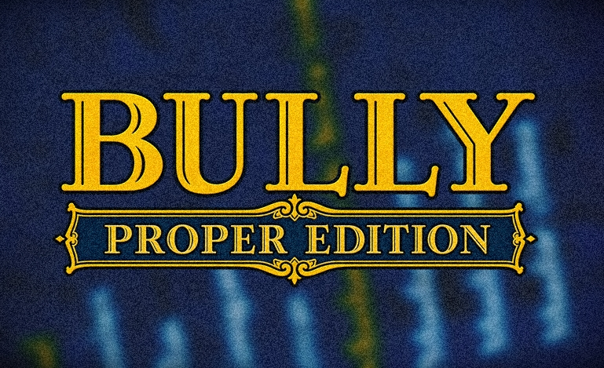

# ✧ Bully Proper Edition

Welcome to the **Bully Proper Edition** repository. This project brings the definitive and enhanced experience to Bully: Scholarship Edition, modernizing visuals, unlocking native performance, and applying essential fixes for modern hardware. All necessary improvements and foundational fixes are included in this standalone release.

---

## ⚠️ Disclaimer

**Bully: Scholarship Edition** is a property of **Rockstar Games** and **Take-Two Interactive**. 
This project is an unofficial community modification and is **NOT** affiliated with, endorsed by, or connected to Rockstar Games or Take-Two Interactive in any way. You must provide your own legal copy of the game to use this software. 

---

## ✨ Features

- **True High FPS:** Native support for 60, 90, and 120 FPS without game speed-ups, physics glitches, or broken missions (perfect sync for minigames).
- **Enhanced World Streaming:** Doubled draw distance with smooth fade-ins, eliminating sudden pop-in for trees, buildings, and distant objects.
- **Upgraded Graphics & Shadows:** Global 4K resolution shadows (4096x), dynamic player/NPC shadows tracking the sun, and optional Xbox 360 visual aesthetics (colors, bloom, fog).
- **Achievements System:** 38 original Xbox 360 achievements fully integrated with on-screen pop-ups and a dedicated Stats menu tracker.
- **Quality of Life:** Borderless/Windowed display modes, point-and-click mouse menus, controller hot-switching, and a Fast Boot option to skip intro logos.
- **Crucial Bug Fixes:** Fixes for surround sound audio blasting at max volume, repeating AI dialogues, flickering textures, and weapon wheel glitches.

---

## 🚀 Installation & Usage

1. Ensure you have a clean installation of **Bully: Scholarship Edition** (Steam version 1.200).
2. Download the latest `.zip` archive from the Releases section.
3. Extract all contents directly into your Bully game directory (overwrite any files if prompted).
4. Launch the game, configure your new settings in the **Video** menu, and enjoy!

---

## 🏆 Credits & Acknowledgements

This project builds upon the incredible work of the modding community. Massive thanks to the following developers:

- **imjbyo:** For the core true FPS patching, shadow enhancements, and major engine fixes.
- **CookiePLMonster (Silent):** For the essential **SilentPatch** foundation that makes these deep engine modifications possible.

---
*Built for the community, by the community.*
